# ShopLite – Maison Argile

Boutique en ligne de céramique artisanale, en microservices, **déployée sur un cluster Kubernetes construit de zéro avec Terraform et Ansible sur Azure**. Le paiement se fait **sur place** : il n'y a volontairement aucune passerelle de paiement.

## Aperçu

<table>
  <tr>
    <td width="50%">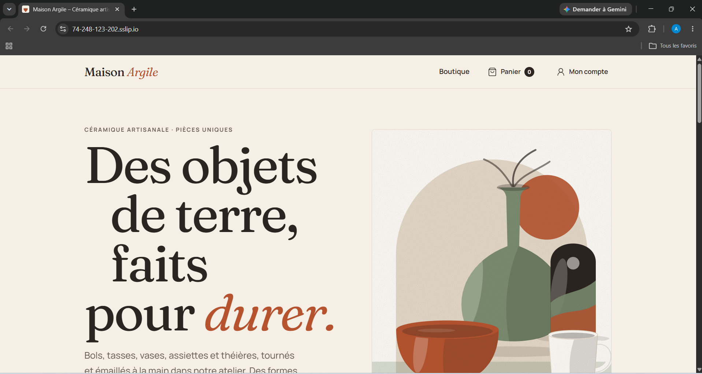</td>
    <td width="50%">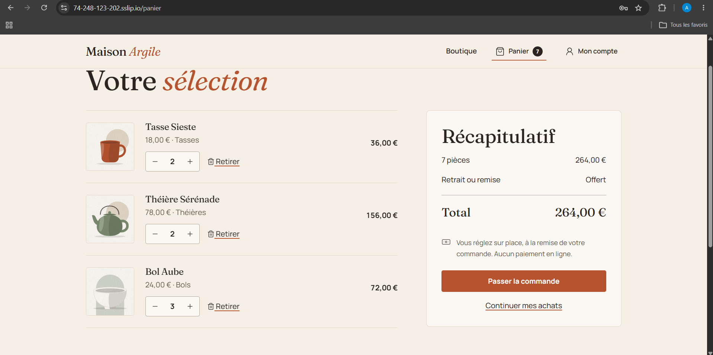</td>
  </tr>
  <tr>
    <td><em>Page d'accueil de Maison Argile, déployée sur le cluster Kubernetes et servie depuis un domaine sslip.io.</em></td>
    <td><em>Page Panier : le récapitulatif est calculé et la commande se règle sur place, sans paiement en ligne.</em></td>
  </tr>
</table>

## Ce que démontre ce projet

- **Infrastructure Azure en Terraform** : réseau virtuel, pare-feu (NSG), deux machines Ubuntu 24.04 et état distant dans un compte de stockage Azure.
- **Cluster Kubernetes 1.36 installé par Ansible avec kubeadm** : inventaire dynamique Azure, durcissement des machines, containerd et Calico, sans service managé (pas d'AKS).
- **Plateforme moderne** : Gateway API avec Traefik, stockage `local-path`, metrics-server sécurisé (certificats de service des kubelets signés par le cluster).
- **HTTPS automatique** : cert-manager et Let's Encrypt (défi HTTP-01 via la Gateway), avec redirection de HTTP vers HTTPS.
- **Supervision** : Prometheus et Grafana, avec un tableau de bord par service selon la méthode RED.
- **Sécurité** : Pod Security `restricted`, pods non-root en lecture seule, secrets chiffrés dans Ansible Vault (jamais dans Git), endpoints techniques bloqués depuis Internet.
- **Reconstruction reproductible** : tout l'environnement se recrée avec deux commandes, `terraform apply` puis `ansible-playbook playbooks/site.yml` (voir [Coûts](#coûts)).

## Chaîne de déploiement

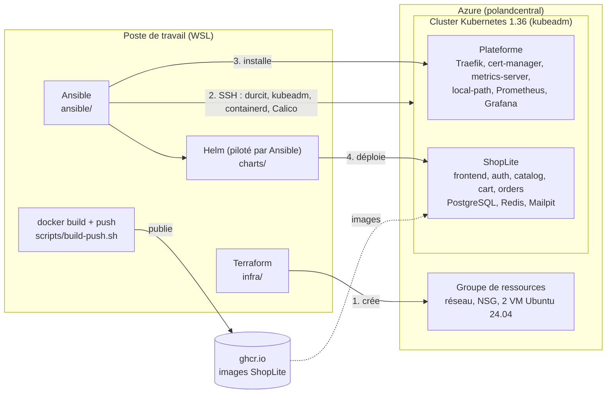

### Technologies et versions

| Domaine | Technologie | Version |
|---|---|---|
| Infrastructure | Terraform | ≥ 1.9 (utilisé : 1.17.1) |
| | Provider `azurerm` / `http` | 4.81.0 (`~> 4.0`) / 3.6.3 (`~> 3.4`) |
| | Machines Azure | `Standard_B2als_v2` (2 vCPU, 4 Go), Ubuntu 24.04 LTS (Canonical) |
| Automatisation | Ansible | ansible-core 2.21.6 (paquet `ansible` 14.6.0) |
| | Collections | `azure.azcollection` 4.2.0, `ansible.posix` 2.2.2, `kubernetes.core` 6.6.0, `community.general` 14.0.0 |
| | Helm | 4.3.0 |
| Kubernetes | Kubernetes (kubeadm, kubelet, kubectl) | 1.36.6 |
| | containerd | 2.4.2 |
| | Calico (opérateur Tigera) | v3.32.3 (VXLAN) |
| Plateforme | Gateway API (CRD standard) | v1.6.3 |
| | Traefik (chart) | 42.3.1 (Traefik v3.7.17) |
| | cert-manager | v1.21.3 |
| | metrics-server (chart) | 3.14.0 (metrics-server 0.9.0) |
| | local-path-provisioner | v0.0.37 |
| | kube-prometheus-stack | 93.1.0 (Prometheus Operator v0.95.1, Grafana 13.3.0) |
| Application | Node.js / Express | 24.22.2 / 5.3.0 |
| | React / Vite | 19.3.1 / 8.3.6 |
| | PostgreSQL / Redis / Mailpit | 17.11 / 7.4.12 / v1.33.0 |
| | Nginx (`nginx-unprivileged`) | 1.31.2 |

Sources : `infra/versions.tf` et `infra/.terraform.lock.hcl`, `ansible/requirements.yml`, `ansible/group_vars/all/kubernetes.yml` et `platform.yml`, `package.json` et `Dockerfile` de chaque service, `docker-compose.yml`. La version de Grafana est celle relevée sur le cluster.

### Organisation du dépôt

| Dossier | Contenu |
|---|---|
| [`infra/`](infra/README.md) | Terraform : groupe de ressources, réseau, NSG, machines virtuelles |
| [`ansible/`](ansible/README.md) | Inventaire dynamique Azure, rôles (durcissement, Kubernetes, plateforme, application), playbooks, coffre Ansible Vault |
| [`charts/`](charts/shoplite/README.md) | Charts Helm `shoplite-data` (PostgreSQL, Redis, Mailpit) et `shoplite` (les cinq services) |
| `scripts/` | Publication des images (`build-push.sh`), génération des secrets du coffre (`gen-vault-secrets.sh`) et des clés locales |
| `services/` | Code de l'application : frontend, auth, catalog, cart, orders |
| [`docs/`](docs/DEVELOPPEMENT.md) | Captures d'écran et documentation de développement |
## Architecture

```
Navigateur ──► frontend (Nginx non-root, :8080) ──┬─ /api/auth/*    ► auth     :3001 ─► PostgreSQL auth_db, Redis (db 0), Mailpit
                                                  ├─ /api/catalog/* ► catalog  :3002 ─► PostgreSQL catalog_db
                                                  ├─ /api/cart/*    ► cart     :3003 ─► Redis (db 1)
                                                  └─ /api/orders/*  ► orders   :3004 ─► PostgreSQL orders_db ─► cart, catalog (HTTP)
```

| Service | Rôle | Stockage |
|---|---|---|
| `services/frontend` | React 19 + Vite, servi par `nginx-unprivileged` (8080) | – |
| `services/auth` | Comptes, sessions, profil, 2FA. **Seul émetteur de jetons** (JWT EdDSA, JWKS public) | PostgreSQL + Redis |
| `services/catalog` | Produits et catégories (lecture publique) | PostgreSQL (lecture seule) |
| `services/cart` | Panier invité (cookie) et panier du compte | Redis |
| `services/orders` | Commandes : relit panier et prix côté serveur | PostgreSQL |

Chaque service a **sa base et son utilisateur** (un propriétaire pour les migrations, un utilisateur applicatif aux droits minimaux). Les services vérifient les jetons avec la **clé publique** du JWKS d'auth et ne connaissent jamais la clé privée. Nginx retire le préfixe `/api/<service>` et bloque `/metrics`, `/docs`, `/healthz`, `/readyz` et `/internal` depuis l'extérieur.

## Déploiement sur Kubernetes (Azure)

L'application tourne sur un cluster Kubernetes (kubeadm) hébergé sur deux machines virtuelles Azure :

- **Infrastructure Azure** : Terraform crée dans [`infra/`](infra/README.md) le réseau, le pare-feu (NSG), un plan de contrôle (`cp-1`) et un nœud de travail (`worker-1`) Ubuntu 24.04 (`terraform init && terraform apply`).
- **Automatisation** : Ansible ([`ansible/`](ansible/README.md)) configure et durcit les machines, installe Kubernetes 1.36 avec containerd et Calico, puis la plateforme (Traefik et Gateway API, cert-manager et Let's Encrypt, metrics-server, stockage local-path, Prometheus et Grafana) et enfin l'application (`ansible-playbook playbooks/site.yml`).
- **Application** : deux charts Helm, [`charts/shoplite-data`](charts/shoplite-data/README.md) (PostgreSQL, Redis, Mailpit) et [`charts/shoplite`](charts/shoplite/README.md) (les cinq services), avec des images publiées par `scripts/build-push.sh`. Les secrets sont dans le coffre Ansible, jamais dans Git.

### Infrastructure Azure

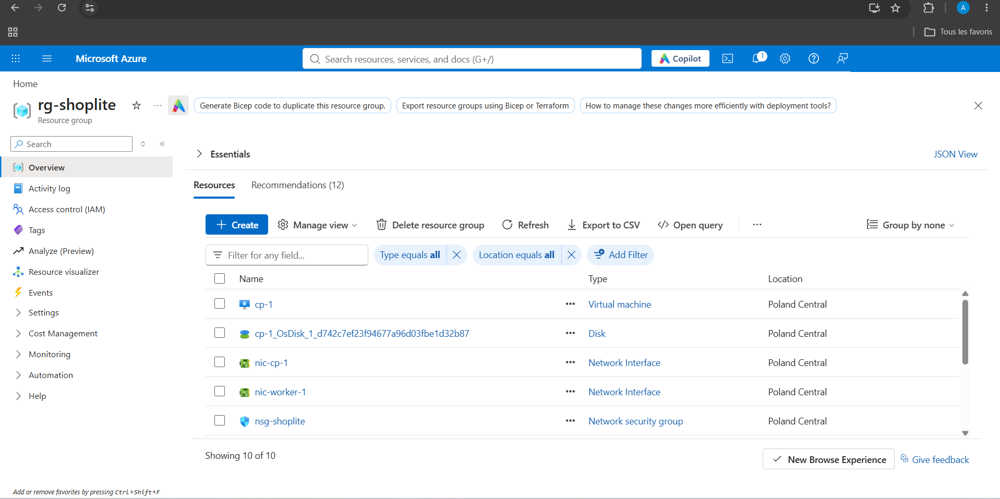

*Le groupe de ressources `rg-shoplite`, créé par Terraform : machines virtuelles, disques, interfaces réseau et groupe de sécurité réseau (NSG).*

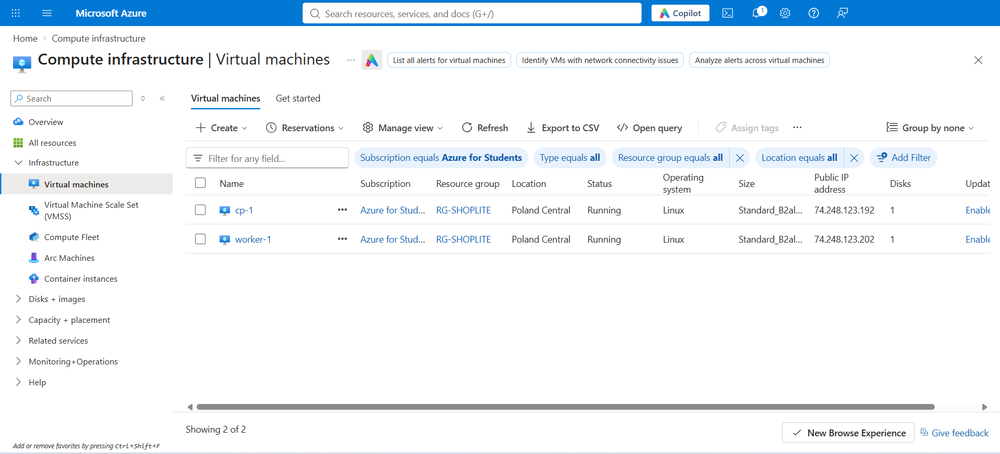

*Les deux machines `cp-1` et `worker-1` (Standard_B2als_v2, Poland Central) sont en cours d'exécution, chacune avec une IP publique.*

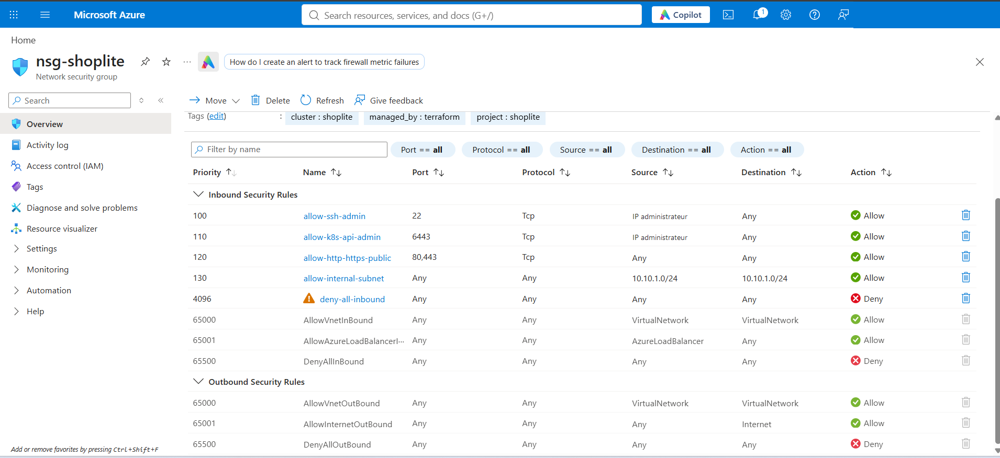

*Pare-feu `nsg-shoplite` : SSH (22) et API Kubernetes (6443) limités à l'adresse de l'administrateur, HTTP/HTTPS ouverts à tous, trafic interne au sous-réseau autorisé et tout le reste refusé.*

### Automatisation (Ansible)

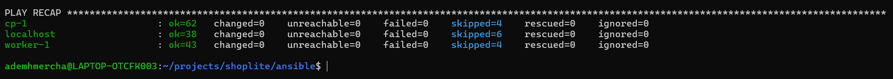

*Seconde exécution de `site.yml` : `changed=0` et `failed=0` sur toutes les cibles. Aucun changement, la configuration est idempotente.*

### Cluster Kubernetes

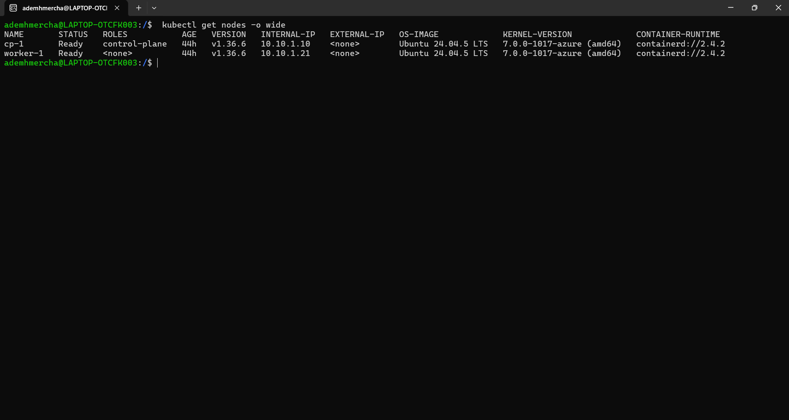

*Les deux nœuds, `cp-1` (plan de contrôle) et `worker-1`, sont `Ready` en Kubernetes v1.36.6 avec containerd 2.4.2.*

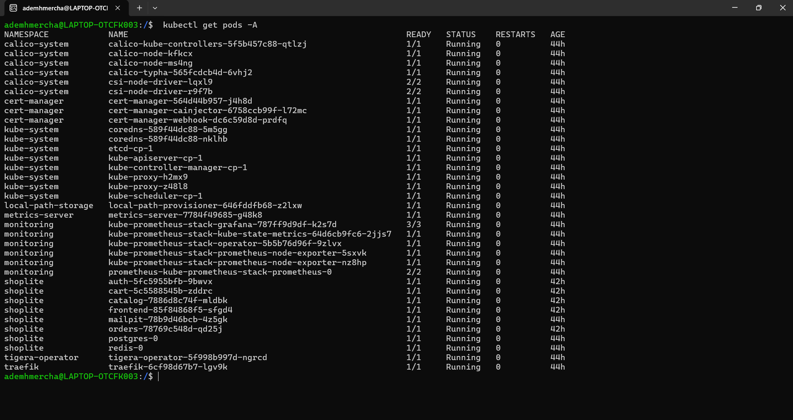

*Tous les pods du cluster sont `Running` et sans redémarrage : système Kubernetes, Calico, cert-manager, Traefik, metrics-server, supervision et ShopLite.*

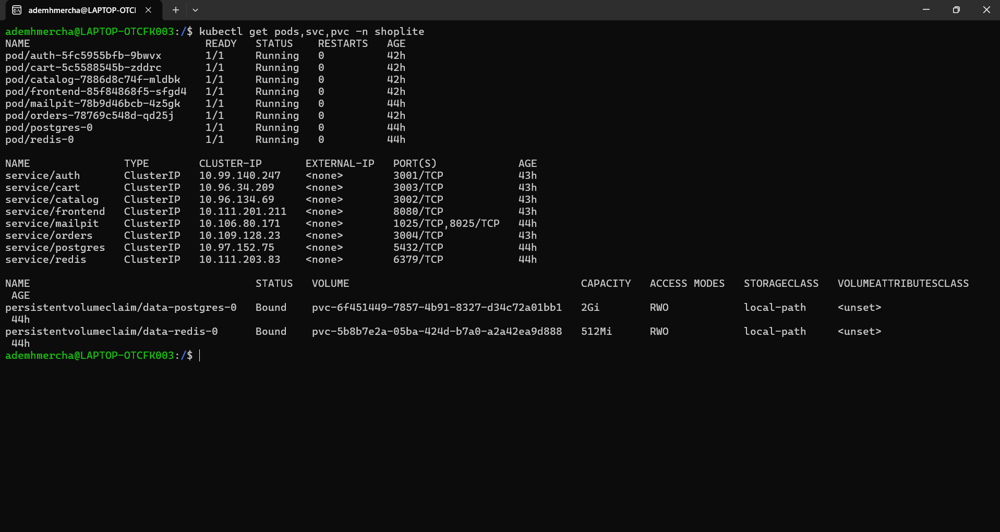

*Namespace `shoplite` : huit pods `Running`, uniquement des Services `ClusterIP` (rien n'est exposé directement) et deux volumes persistants (PostgreSQL et Redis) liés par `local-path`.*

### Sécurité du déploiement

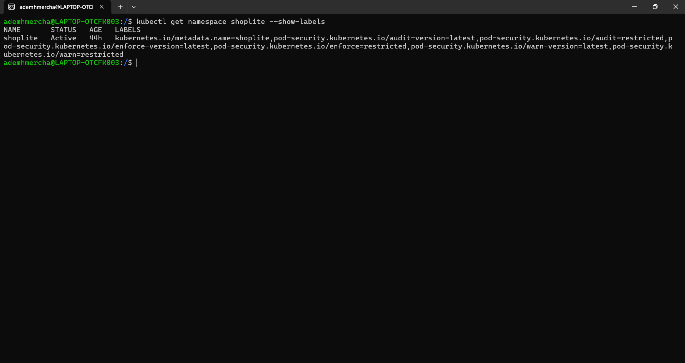

*Le namespace `shoplite` applique Pod Security Admission au niveau `restricted` (enforce, audit et warn) : tout pod non conforme est refusé.*

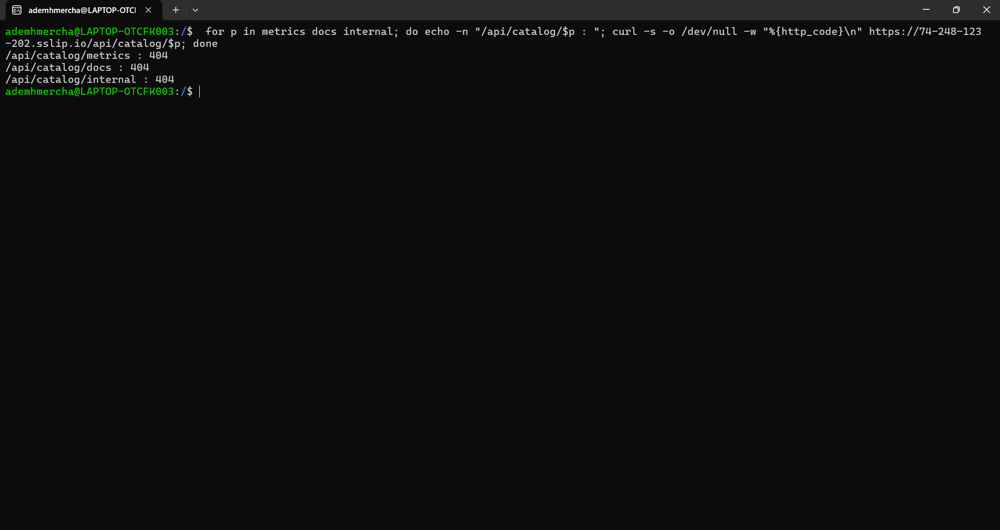

*Depuis Internet, `/metrics`, `/docs` et `/internal` du service catalogue répondent 404 : Nginx bloque les endpoints techniques.*

### Supervision

Grafana n'est pas exposé sur Internet : accès par `kubectl port-forward` (voir [`ansible/README.md`](ansible/README.md)).

<table>
  <tr>
    <td width="50%">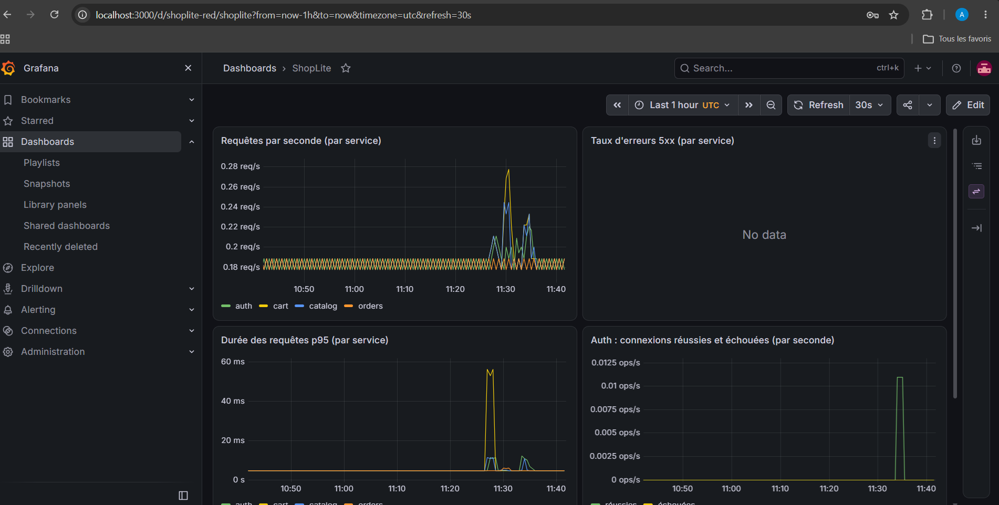</td>
    <td width="50%">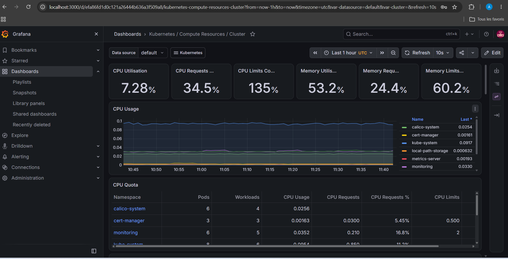</td>
  </tr>
  <tr>
    <td><em>Tableau de bord ShopLite (méthode RED) : requêtes par seconde, durée p95 et connexions du service auth. Le panneau « Taux d'erreurs 5xx » affiche « No data » : aucune erreur 5xx observée.</em></td>
    <td><em>Tableau de bord Kubernetes / Compute Resources / Cluster : utilisation CPU et mémoire du cluster, par namespace.</em></td>
  </tr>
</table>

## Problèmes rencontrés et solutions

**Tailles de machines bloquées par l'abonnement étudiant.** *Contexte :* la création des machines `Standard_B2als_v2` échouait avec l'abonnement « Azure for Students ». *Cause :* la restriction `NotAvailableForSubscription` s'applique à cette taille : elle interdit la région elle-même en `italynorth`, `germanywestcentral` et `francecentral`, la limite aux zones de disponibilité en `austriaeast`, et seule `polandcentral` n'a aucune restriction. *Solution :* `polandcentral` par défaut, une variable `location` validée sur les cinq régions autorisées, et des machines sans zone de disponibilité. Le quota régional de 6 vCPU limite en plus le cluster à 3 machines.

**Calico en VXLAN.** *Contexte :* le réseau des pods doit relier les nœuds entre eux. *Cause :* Azure bloque le protocole IP-in-IP (IP 4) entre machines virtuelles, l'encapsulation habituelle de Calico. *Solution :* encapsulation VXLAN (UDP 4789, déjà autorisé par la règle interne du NSG), BGP désactivé, et transfert IP activé sur les interfaces réseau.

**Condition de concurrence au premier démarrage de PostgreSQL.** *Contexte :* au premier lancement, les migrations échouaient parfois alors que la base semblait prête. *Cause :* l'image PostgreSQL démarre un serveur temporaire, joignable seulement par socket Unix, pour exécuter les scripts d'initialisation, puis le redémarre : un contrôle de santé sur le socket le déclare prêt trop tôt. *Solution :* contrôle de santé en TCP (`pg_isready -h 127.0.0.1`), dans le compose comme dans les sondes Kubernetes, et migrations qui réessaient jusqu'à 10 fois avec un délai croissant (seules les erreurs de connexion sont réessayées).

**Gateway API et Traefik plutôt qu'Ingress NGINX.** *Contexte :* il faut exposer le site en HTTP/HTTPS sans répartiteur de charge cloud. *Cause :* Ingress NGINX a été retiré en mars 2026 (information externe au dépôt) et l'API Ingress est figée au profit de la Gateway API. *Solution :* CRD Gateway API v1.6.3 et Traefik comme contrôleur, une Gateway partagée `traefik/shoplite` (écouteurs HTTP et HTTPS), une HTTPRoute par application, Traefik en `hostPort` 80/443 sur le nœud de travail, et cert-manager qui émet le certificat par défi HTTP-01 via cette Gateway.

**Vraie adresse IP des visiteurs derrière Traefik.** *Contexte :* les requêtes traversent Traefik puis le Nginx du frontend avant d'atteindre les services. *Cause :* Nginx voyait l'adresse du pod Traefik comme client et la transmettait aux services, si bien que la limitation du nombre de tentatives par IP aurait été partagée entre tous les visiteurs. *Solution :* `set_real_ip_from` limité au CIDR des pods (donc aux pods Traefik) avec `real_ip_header X-Forwarded-For` dans le Nginx du frontend, et `TRUST_PROXY=2` pour les services. L'adresse réelle du visiteur apparaît dans les journaux d'audit.

**IP dynamique de l'administrateur.** *Contexte :* SSH (22) et l'API Kubernetes (6443) ne doivent être joignables que depuis la machine de l'administrateur, dont l'IP publique change. *Cause :* le NSG est fixé à une adresse précise. *Solution :* Terraform détecte l'IP publique à chaque `plan` (source `http` vers `api.ipify.org`, remplaçable par la variable `allowed_cidrs`), donc un `terraform apply` met à jour le pare-feu.

## Coûts

L'environnement est **éphémère** : il est conçu pour être créé au début d'une séance de travail et détruit à la fin, car les machines Azure sont facturées tant qu'elles existent. Estimation de `infra/README.md` : environ 0,10 €/h pour deux machines (calcul, IP publiques et disques), à vérifier sur le calculateur Azure.

```bash
# Reconstruction complète (prérequis : az login, ARM_SUBSCRIPTION_ID, clé SSH, images publiées : voir infra/README.md)
cd infra && terraform apply
cd ../ansible && ansible-playbook playbooks/site.yml

# Destruction (arrête la facturation)
cd ../infra && terraform destroy
```

`site.yml` enchaîne le durcissement des machines, Kubernetes, la plateforme et l'application. Le domaine sslip.io suit l'IP publique de `worker-1` : il change à chaque reconstruction, et un nouveau certificat est alors émis.

## Développement de l'application

L'application (cinq services Node.js et un frontend React) se lance aussi en local avec Docker Compose, sans cluster :

```bash
node scripts/gen-keys.mjs        # crée .secrets/ et .env (ignorés par Git)
docker compose up --build        # site : http://localhost:8080
```

Le détail (comptes de démonstration, tests, routes de l'API, conventions backend, design) est dans [`docs/DEVELOPPEMENT.md`](docs/DEVELOPPEMENT.md). Voir aussi [SECURITY.md](SECURITY.md).